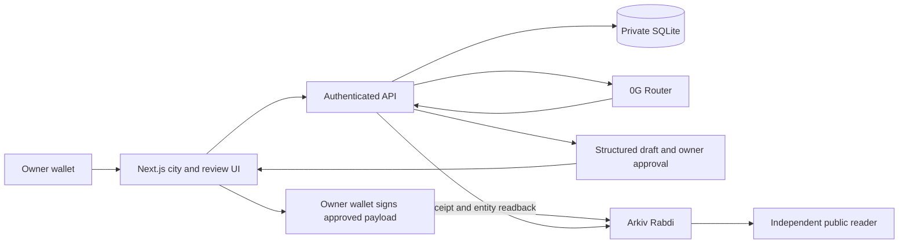

# BriefMint · Tool City

**Turn private project notes into structured, owner-approved public opportunities.**

Built for ETHGlobal Mumbai, BriefMint combines a wallet-authenticated private workspace, 0G-assisted drafting, and owner-signed Arkiv publication inside an interactive isometric Tool City. The owner decides what crosses the boundary from private preparation to public discovery.

**Demonstrated:** wallet sign-in → saved private notes → genuine 0G-generated draft → owner edits and exact approval → Arkiv create, receipt/readback and public discovery. [Live evidence and limitations](docs/evidence/LIVE_DEMO.md) distinguish observed results from offline tests.

## Problem and solution

Project leads start with messy notes containing internal constraints and unfinished ideas. Turning them into a clear contributor opportunity takes work; publishing the original notes risks disclosure. BriefMint proposes deliverables, acceptance criteria, exclusions and clarification questions, then requires human review of a separate public projection before publication.

## Core features

- Wallet authentication and owner-scoped private notes, source references, immutable original output, saved edits and restart recovery.
- Structured 0G generation with bounded quotas, explicit dispatch, strict response validation, private routing requested and no fallback.
- Revision-bound approval of deterministic canonical public JSON and its SHA-256 hash. Editing invalidates approval.
- Browser-wallet Arkiv publication with immediate transaction-hash capture and backend receipt/entity verification.
- Indexed public discovery and a standalone read-only client independent of BriefMint's API, cookies and SQLite.
- Owner update/close, archival and private/public exports. **Update, close and native expiry have offline coverage; they have not been demonstrated live.**

## How it works

1. Connect the owner wallet and sign in; save project notes privately.
2. Deliberately request a structured draft. Opening or refreshing an existing brief does not call AI again.
3. Review the saved output, edit it and inspect the exact public preview.
4. Approve a specific revision and canonical public-payload hash.
5. Let the owner's browser wallet sign the prepared Arkiv operation. The backend checks receipt, signer, entity content, revision and expiry before recording publication.
6. Discover the public opportunity through Arkiv's index or the independent reader.

## Architecture



The browser sends only the approved public intent to Arkiv. SQLite is never copied onto the chain. See [detailed architecture and trust diagrams](docs/architecture/ARCHITECTURE.md).

| Technology | Actual role |
|---|---|
| Next.js 16.4.5 / React 19.3 / TypeScript | One frontend and Node API application; App Router pages and handlers |
| Pixi.js 8, SVG/CSS overlays | Interactive city experience and workflow entry points |
| Node 24 / built-in SQLite | Private persistence, additive migrations, quota and execution leases |
| Zod 4 | Strict shared request, response and public-payload validation |
| wagmi 3 / viem 2 / MetaMask | Browser wallet connection, authentication and owner signing |
| 0G Router / `0gm-1.0-35b-a3b` | Structured drafting through requested private inference |
| Arkiv SDK 1.0.1 / Rabdi | Wallet-owned entities, indexed public queries, receipt/readback |
| Vitest / ESLint / TypeScript | Offline regression tests and static checks |

Legacy translation, Whitechain checkout, Solidity contracts and the checkout example remain isolated historical functionality. BriefMint requires no Whitechain funds, escrow, applicant handling or funded bounty.

## Why 0G

0G supplies the drafting capability in the main workflow, rather than an ornamental integration. The server calls `https://router-api.0g.ai/v1` using the pinned model, private trust policy, `verify_tee: true`, disabled fallbacks, bounded timeout and no automatic retry. It validates the structured reply and saves sanitized request/model/provider evidence with the original result.

A real app generation succeeded. **Private routing and verification were requested; independent cryptographic TEE execution was not established.** The observed Router verification and routing-tier metadata were absent. Neither a successful response nor a provider address proves attestation. See [request evidence](docs/evidence/LIVE_DEMO.md) and the [guarded 0G probe](docs/briefmint/0G_LIVE_PROBE.md). No unique-to-0G security guarantee is asserted beyond observed configuration and evidence.

## Why Arkiv

Arkiv makes the reviewed opportunity a wallet-owned, queryable public entity rather than a row available only through our API. Its indexed schema supports category/language/status/budget/deadline queries; `$owner`, `$key` and `$expiresAt` come from network state. A separate reader can discover data while the BriefMint backend is stopped.

The named schema is `tool-city.opportunity.v1` on **Rabdi, chain 7794095**. Owner wallet: `0xD582d7C24528a3f0294aCAFA46Fae6e797b76aB8`. The [schema](arkiv/schema.md), [usage](arkiv/how-you-use-arkiv.md), [rationale](arkiv/why-arkiv.md), [friction](arkiv/friction.md) and [reach](arkiv/reach.md) describe the actual integration. Native expiry is a network block height; the business deadline is a timestamp. Creation derives lifetime from deadline and observed block timing; patches do not extend it. Closing does not erase existing copies.

## Security and privacy

Private notes, source IDs, inference evidence and internal identifiers stay in the access-controlled backend. Session cookies are HttpOnly, SameSite=Lax and Secure over HTTPS; private operations enforce origin, session owner and the matching `x-briefmint-owner` header. BriefMint wallet authentication uses chain 7794095, separately from legacy checkout.

Only title, summary, category, language, optional unfunded budget/contact, deadline, structured public sections, status and schema/revision metadata enter the public projection. Approval is bound to its exact hash. A hash or transaction alone is not publication success: confirmed receipt plus matching entity readback is required. Unknown broadcasts stay locked; no automatic resubmission occurs.

**The backend and configured inference service process the notes. Storage is not end-to-end encrypted.** Schema validation omits private fields structurally but cannot detect a private fact copied into approved prose. Review wording before approving. Public data and backups can outlive closure or expiry. Do not put real secrets in notes.

## Run locally

Requires Node **24.x**, npm and a persistent writable disk. From a fresh checkout:

```sh
npm ci
test -e .env.local || cp .env.example .env.local
npm run dev -- --hostname 127.0.0.1 --port 3001
```

Before signing in, edit the ignored `.env.local` locally: set `APP_ORIGIN=http://127.0.0.1:3001`, matching `AUTH_ALLOWED_ORIGINS`, and a random `SESSION_SECRET` of at least 32 characters. `DATABASE_PATH=./data/tool-city.sqlite` stores private data; preserve it. Never overwrite an existing environment file or database. Open `http://127.0.0.1:3001`; `/briefs` is the private archive and `/opportunities` is public discovery. API routes are same-origin: no separate Vite frontend or CORS proxy is needed.

| Server configuration | Purpose |
|---|---|
| `APP_ORIGIN`, `AUTH_ALLOWED_ORIGINS`, `SESSION_SECRET`, `DATABASE_PATH` | Origin, owner sessions and persistence |
| `ZERO_G_API_KEY`, `ZERO_G_BASE_URL`, `ZERO_G_MODEL_ID`, `INFERENCE_TIMEOUT_MS` | Server-only 0G credentials, route/model and timeout |
| `BRIEFMINT_ALLOWED_WALLETS`, `BRIEFMINT_COMPILATIONS_PER_WALLET` | Explicit operator wallet allowlist and new-brief allowance |
| `BRIEFMINT_GLOBAL_DISPATCH_LIMIT`, `BRIEFMINT_QUOTA_WINDOW_ID`, `BRIEFMINT_QUOTA_WINDOW_END` | Dispatch ceiling and finite quota window |
| `ARKIV_ACCESS_KEY` | Server readback access/rate-limit configuration; not a wallet credential |

Empty/invalid quota configuration disables compilation. Each dispatched attempt counts globally even if uncertain; the per-wallet limit counts distinct briefs first started in the window. Current operator inference quota is exhausted: reuse saved results. No key belongs in `NEXT_PUBLIC_*`, Git, logs, screenshots or chat. The browser's Arkiv reader accepts a deliberately public endpoint access key locally; it never needs a private key.

For the existing operator-only ignored `.env.0g-smoke`, the safe server launcher loads allowlisted inference settings without printing them or calling inference:

```sh
npm run dev:briefmint-0g -- --hostname 127.0.0.1 --port 3001
```

A fresh clone contains no private database, credentials or generated drafts. Configuring credentials does not authorize spending. New inference and wallet writes require explicit operator approval. Configure MetaMask for Rabdi chain 7794095 using the installed SDK's [official network configuration](https://docs.arkiv.network/); publication needs testnet gas and the actual owner account. Do not import a private key into this application.

For production, `npm run build` then `HOSTNAME=127.0.0.1 PORT=3001 npm start` starts the standalone server. Put it behind HTTPS, configure the real public origin, and use **one Node process with a persistent SQLite volume**, not disposable serverless storage or independent replicas. Back up the database consistently, restrict volume access, and define retention separately. No public hosted demo is established. See [operator runbook](docs/briefmint/LIVE_VALIDATION_AND_SUBMISSION.md).

## Demo and independent read

The demonstrated opportunity is **Developer onboarding document [demo 2a69f504]**, revision 1, writing, open. Entity:

`0x85ea1b83ec04c6f9ff795d75cfbd5f2d136cb69bb571c4ec6ec18dce648bb121`

Read directly, without login, private DB or BriefMint API:

```sh
node --import tsx scripts/briefmint-arkiv-reader.ts --get 0x85ea1b83ec04c6f9ff795d75cfbd5f2d136cb69bb571c4ec6ec18dce648bb121 --public-endpoint
node --import tsx scripts/briefmint-arkiv-reader.ts --list --public-endpoint --status open --category writing --limit 20
```

The anonymous endpoint can return HTTP 429; failed queries are not an empty catalogue. Use [live evidence](docs/evidence/LIVE_DEMO.md) for transaction/hash/expiry and the [2½-minute demo guide](docs/submission/DEMO_GUIDE.md) to reuse existing artifacts without more inference or transactions. This entity is a separately approved copy of a genuine generated draft; the original R3 attempt remains unknown and must not be retried. Duplicate-content risk remains disclosed.

## Verification

```sh
npm test
npm run typecheck
npm run lint
npm run build
npm run smoke:local
```

Tests use labeled synthetic inference and chain fixtures: they are not live sponsor evidence. `npm test` runs server and UI suites. Build also packages the separate legacy checkout example. `smoke:local` uses disposable synthetic data and no paid integrations. Legacy simulated-chain tests are available separately with `npm run test:contracts`; do not run deployment commands for BriefMint. See [submission verification](docs/submission/VERIFICATION.md) for actual results from this documentation checkpoint.

## Limits and next work

- Independent TEE verification is unavailable; the model may generate incorrect or sensitive prose.
- Original R3 broadcast has no known hash and remains unresolved. Nonce zero/empty explorer history do not prove nonbroadcast.
- Live create/read/discovery succeeded; live owner update, close and native expiry remain unverified. No expiry extension or reopening is provided.
- Rabdi/Router availability, rate limits, testnet gas and operator compute quota affect readiness. Measured promotional-credit debit was not established.
- HTTPS hosting, live lifecycle validation and asset/license clearance remain submission prerequisites. No open-source license has yet been selected for the repository.

Next work: validate attestation when supported, reconcile the old intent with authoritative evidence, test live lifecycle under separate consent, and deploy a persistent demo. No new sponsors or payment scope are needed.

## Team, attribution and submission

Verified Git contributor identities: **0xsan7, mevarx, VARX!!**; history also includes `usehoplite[bot]`. Roles and affiliations are not inferred. AI assistance was used for planning, code, tests and documentation. This is not an official partnership or award claim.

[Attribution and license status](docs/submission/ATTRIBUTION.md) identifies inherited code/assets and unresolved rights. There is no root license; the operator must confirm rights and choose an appropriate license before claiming open-source eligibility. [Submission copy](docs/submission/ETHGLOBAL_SUBMISSION.md), [recording checklist](docs/submission/RECORDING_CHECKLIST.md) and [architecture](docs/architecture/ARCHITECTURE.md) are ready for review; replace public demo/video/contact placeholders only with verified details.
